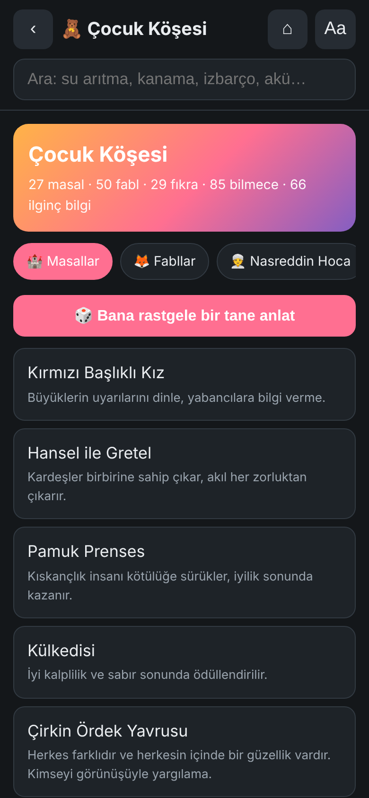
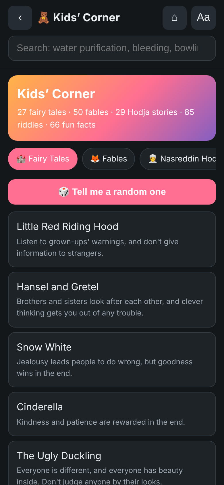

# Hayatta Kalma Rehberi

**İnternet olmadan çalışan, Türkçe, ücretsiz hayatta kalma ve afet rehberi.**

Deprem, savaş, sel, uzun süreli elektrik kesintisi gibi durumlarda telefonunuzda, internete ihtiyaç duymadan açabileceğiniz bir el kitabı. Tek bir HTML dosyasından oluşur, kurulum gerektirmez, reklam ve takip içermez.

👉 **Uygulamayı açın:** https://hayattakal.github.io/hayatta-kalma-rehberi/

🇬🇧 **English version:** https://hayattakal.github.io/hayatta-kalma-rehberi/en/ ([jump to English](#english))

## Telefona kurulum

**iPhone (Safari):** Adresi açın → Paylaş → **Ana Ekrana Ekle**. Bir kez internet varken açıp birkaç sayfa gezin. Sonra uçak modunda da çalışır.

**Android (Chrome):** Adresi açın → ⋮ menüsü → **Ana ekrana ekle / Uygulamayı yükle**.

**Bilgisayar veya internet hiç yoksa:** `index.html` dosyasını indirip telefona veya bilgisayara kopyalayın ve tarayıcıda açın.

## İçerik

- **424 konu, 46 bölüm, 85 çizim ve animasyon**
- Elektriğe ulaşım ve üretim (DC/AC motor, su, rüzgâr, güneş, pedal, akü, diyot ve parça bulma rehberi)
- Afet ve savaş, sığınak yapımı, nükleer ve kimyasal tehdit, korunma
- İlk yardım, hastalıklar, bitkisel çözümler, psikolojik dayanıklılık, aile sağlığı
- Su bulma ve arıtma, ateş, barınak, iklim, dağ ve su kenarı
- Yenen ve zehirli bitkiler, av ve tuzaklar, beslenme, bahçe, hayvancılık, gıda saklama
- İlkel yaşam, düğümler, inşaat, tamir, dokuma, basit makineler
- Haberleşme, yön bulma, harita okuma, topluluk düzeni

## Araçlar

El feneri ve SOS, Mors çevirici, düdük, KPR ritmi, pusula ve GPS, Türkiye haritası, hesaplayıcılar, stok ve ilaç takibi, günlük, gün doğumu ve ay evresi, acil durum kartı, sözlük (EN, DE, FR, AR, FA, RU), sınavlar, senaryolar ve sesli okuma.

## Çocuk köşesi

Telif hakkı süresi dolmuş dünya masalları (Grimm, Andersen, Perrault, Binbir Gece, Dede Korkut ve Keloğlan) asıllarına yakın uzunlukta, çocuklara uygun bir dille yeniden anlatıldı. Ayrıca Ezop fablları, Nasreddin Hoca fıkraları, bilmeceler, oyunlar ve ilginç bilgiler var.

## Önemli uyarı

Bu rehber genel bilgi amaçlıdır. Doktor, veteriner, elektrikçi veya resmî afet kurumlarının (AFAD, 112) yerini tutmaz. Mümkün olduğunda her zaman profesyonel yardım alın ve resmî uyarıları izleyin.

## Kaynaklar ve teşekkür

İçerik; AFAD, FEMA ve Ready.gov, CDC, Dünya Sağlık Örgütü (WHO), ABD FDA ve Sığınak Yönetmeliği gibi kamuya açık kaynaklardaki genel bilgiler esas alınarak, sade Türkçeyle yeniden yazılmıştır. Türkiye haritası: turkey-map-react (MIT), il bilgileri: memleketim-tr-cities (MIT). Bütün çizimler bu proje için hazırlanmıştır.

## Katkı

Hata bildirmek veya konu önermek için [Issues](../../issues) bölümünü kullanabilirsiniz.

---

# 🇬🇧 Survival Guide (English)

**A free survival and disaster guide that works without the internet.**

A handbook you can open on your phone with no connection during an earthquake, war, flood or long power cut. It is a single HTML file: no install, no ads, no tracking.

👉 **Open the app:** https://hayattakal.github.io/hayatta-kalma-rehberi/en/

## Install on your phone

**iPhone (Safari):** open the link → Share → **Add to Home Screen**. Open it once while online and browse a few pages; after that it works in airplane mode.

**Android (Chrome):** open the link → ⋮ menu → **Add to Home screen / Install app**.

**No internet at all:** download `en/index.html`, copy it to your phone or computer and open it in a browser.

## What's inside

- **424 articles in 46 sections, 85 illustrations and animations**
- Getting and generating electricity (DC/AC motors, water, wind, solar, pedal power, batteries, diodes, scavenging parts)
- Disasters and war, building shelters, nuclear and chemical threats, protection
- First aid, illnesses, herbal remedies, psychological resilience, family health
- Finding and purifying water, fire, shelter, climate, mountains and water safety
- Edible and poisonous plants, hunting and trapping, nutrition, gardening, livestock, food storage
- Primitive skills, knots, building, repairs, weaving, simple machines
- Communication, navigation, map reading, community organization

## Tools

Flashlight and SOS, Morse translator, whistle, CPR rhythm, compass and GPS, world and Türkiye maps, calculators, supply and medicine trackers, log, sunrise and moon phase, emergency card, phrasebook (Turkish, German, French, Arabic, Persian, Russian), quizzes, scenarios and read-aloud.

## Kids' Corner

Public-domain fairy tales (Grimm, Andersen, Perrault, the Arabian Nights, Dede Korkut and Turkish Keloğlan tales) retold at close to their original length in child-friendly English, plus Aesop's fables, Nasreddin Hodja stories, riddles, tongue twisters, games and fun facts.

## Important

This guide is for general information. It does not replace a doctor, vet, electrician or official emergency services (112 in Europe and Türkiye, 911 in North America). Always get professional help when you can and follow official warnings.

## Sources

Content is based on general information from public sources such as AFAD, FEMA and Ready.gov, the CDC, the World Health Organization (WHO) and the US FDA, rewritten in plain language. It was originally written in Turkish and translated into English. Türkiye map: turkey-map-react (MIT); province data: memleketim-tr-cities (MIT). All illustrations were made for this project.

## Contributing

Report errors or suggest topics in [Issues](../../issues).
