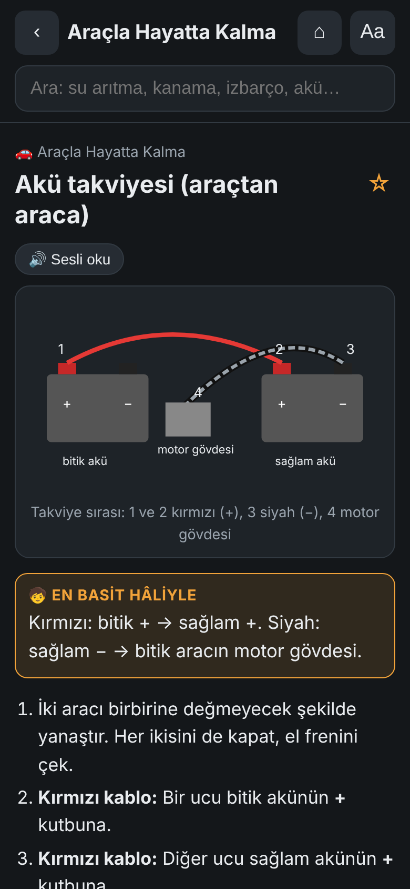
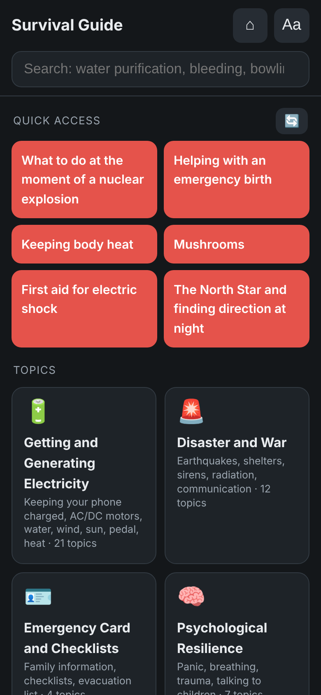
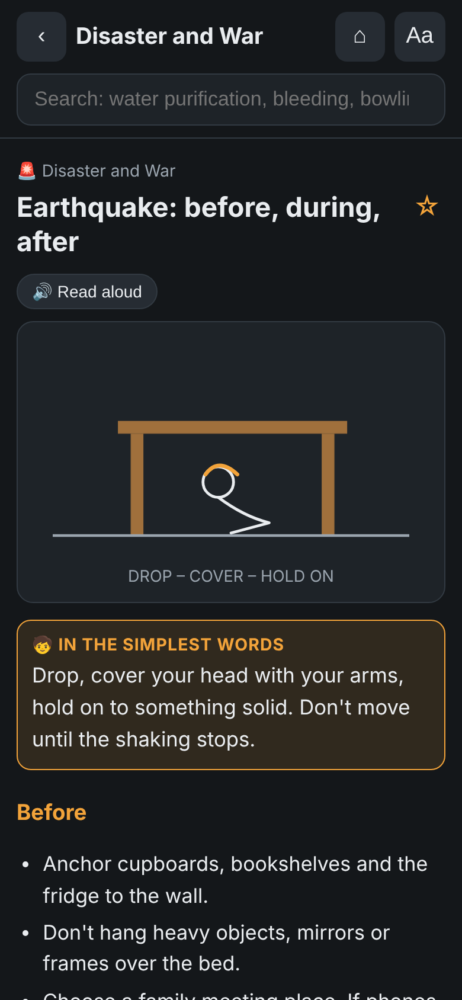
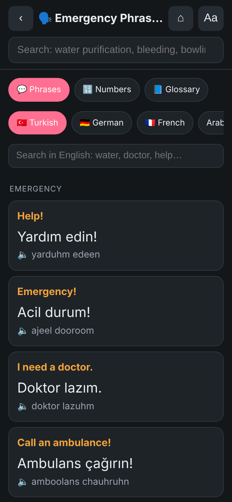

# Hayatta Kalma Rehberi

**İnternet olmadan çalışan, Türkçe, ücretsiz hayatta kalma ve afet rehberi.**

Deprem, savaş, sel, uzun süreli elektrik kesintisi gibi durumlarda telefonunuzda, internete ihtiyaç duymadan açabileceğiniz bir el kitabı. Tek bir HTML dosyasından oluşur, kurulum gerektirmez, reklam ve takip içermez.

👉 **Uygulamayı açın:** https://hayattakal.github.io/hayatta-kalma-rehberi/

🇬🇧 **English version:** https://hayattakal.github.io/hayatta-kalma-rehberi/en/ ([jump to English](#english))

## Telefona kurulum

**iPhone (Safari):** Adresi açın → Paylaş → **Ana Ekrana Ekle**. Bir kez internet varken açıp birkaç sayfa gezin. Sonra uçak modunda da çalışır.

**Android (Chrome):** Adresi açın → ⋮ menüsü → **Ana ekrana ekle / Uygulamayı yükle**.

**Bilgisayar veya internet hiç yoksa:** `index.html` dosyasını indirip telefona veya bilgisayara kopyalayın ve tarayıcıda açın.

## İçerik

- **432 konu, 46 bölüm, 88 çizim ve animasyon**
- Elektriğe ulaşım ve üretim (DC/AC motor, su, rüzgâr, güneş, pedal, akü, diyot ve parça bulma rehberi)
- Afet ve savaş, sığınak yapımı, nükleer ve kimyasal tehdit, korunma
- İlk yardım, hastalıklar, bitkisel çözümler, psikolojik dayanıklılık, aile sağlığı
- Su bulma ve arıtma, ateş, barınak, iklim, dağ ve su kenarı
- Yenen ve zehirli bitkiler, av ve tuzaklar, beslenme, bahçe, hayvancılık, gıda saklama
- İlkel yaşam, düğümler, inşaat, tamir, dokuma, basit makineler
- Haberleşme, yön bulma, harita okuma, topluluk düzeni

## Araçlar

El feneri ve SOS, Mors çevirici, düdük, KPR ritmi, pusula ve GPS, Türkiye haritası, hesaplayıcılar, stok ve ilaç takibi, günlük, gün doğumu ve ay evresi, acil durum kartı, sözlük (EN, DE, FR, AR, FA, RU), sınavlar, senaryolar ve sesli okuma.

## Çocuk köşesi

Telif hakkı süresi dolmuş dünya masalları (Grimm, Andersen, Perrault, Binbir Gece, Dede Korkut ve Keloğlan) asıllarına yakın uzunlukta, çocuklara uygun bir dille yeniden anlatıldı. Ayrıca Ezop fablları, Nasreddin Hoca fıkraları, bilmeceler, oyunlar ve ilginç bilgiler var.

## Önemli uyarı

Bu rehber genel bilgi amaçlıdır. Doktor, veteriner, elektrikçi veya resmî afet kurumlarının (AFAD, 112) yerini tutmaz. Mümkün olduğunda her zaman profesyonel yardım alın ve resmî uyarıları izleyin.

## Gizlilik

Rehber hiçbir kişisel veri toplamaz. Hesap, reklam, analiz ya da takip aracı yoktur. Ayrıntılar: [Gizlilik politikası](https://hayattakal.github.io/hayatta-kalma-rehberi/gizlilik.html)

## Kaynaklar ve teşekkür

İçerik, kamuya açık kaynaklardaki bilgiler esas alınarak sade Türkçeyle yeniden yazılmıştır. Tam liste uygulamadaki **Bu rehberin dayandığı kaynaklar** konusunda yer alır ve her güncellemede yenilenir (son güncelleme: 22 Kasım 2026).

- **Genel hayatta kalma:** ABD Kara Kuvvetleri ATP 3-50.21, FM 21-76 ve FM 21-76-1; FEMA "Are You Ready?" ve Ready.gov
- **Afet, sığınak ve nükleer tehdit:** AFAD, Sığınak Yönetmeliği, Nuclear War Survival Skills (Kearny, 1979), FDA ve CDC potasyum iyodür rehberleri
- **İlk yardım ve sağlık:** Avrupa Resüsitasyon Konseyi (ERC) İlk Yardım Kılavuzları 2021 ve 2025, ILCOR değerlendirmeleri, Amerikan Kalp Derneği ve Amerikan Kızılhaçı İlk Yardım Kılavuzu (2024), Birleşik Krallık Resüsitasyon Konseyi anafilaksi kılavuzu, NHS ve Asthma + Lung UK, Dünya Sağlık Örgütü, Ulusal Zehir Danışma Merkezi (114)
- **Su:** ABD Çevre Koruma Ajansı (EPA), Hacettepe Üniversitesi Halk Sağlığı Anabilim Dalı afet bilgi notu
- **Çocuk köşesi:** Telif süresi dolmuş Grimm, Andersen, Perrault, Binbir Gece, Dede Korkut, Ezop ve Collodi eserleri; Keloğlan masalları ve Nasreddin Hoca fıkraları
- **Harita:** turkey-map-react (MIT), memleketim-tr-cities (MIT). Bütün çizimler bu proje için hazırlanmıştır.

## Katkı ve hata bildirimi

Uygulamadaki her konunun altında bir **Hata bildir** düğmesi var. Düğme, konu adını içeren hazır bir e-posta açar. Hata ve önerilerinizi doğrudan **dr.ozayapps@gmail.com** adresine de yazabilir ya da [Issues](../../issues) bölümünü kullanabilirsiniz.

---

# 🇬🇧 Survival Guide (English)

**A free survival and disaster guide that works without the internet.**

A handbook you can open on your phone with no connection during an earthquake, war, flood or long power cut. It is a single HTML file: no install, no ads, no tracking.

👉 **Open the app:** https://hayattakal.github.io/hayatta-kalma-rehberi/en/

## Install on your phone

**iPhone (Safari):** open the link → Share → **Add to Home Screen**. Open it once while online and browse a few pages; after that it works in airplane mode.

**Android (Chrome):** open the link → ⋮ menu → **Add to Home screen / Install app**.

**No internet at all:** download `en/index.html`, copy it to your phone or computer and open it in a browser.

## What's inside

- **432 articles in 46 sections, 88 illustrations and animations**
- Getting and generating electricity (DC/AC motors, water, wind, solar, pedal power, batteries, diodes, scavenging parts)
- Disasters and war, building shelters, nuclear and chemical threats, protection
- First aid, illnesses, herbal remedies, psychological resilience, family health
- Finding and purifying water, fire, shelter, climate, mountains and water safety
- Edible and poisonous plants, hunting and trapping, nutrition, gardening, livestock, food storage
- Primitive skills, knots, building, repairs, weaving, simple machines
- Communication, navigation, map reading, community organization

## Tools

Flashlight and SOS, Morse translator, whistle, CPR rhythm, compass and GPS, world and Türkiye maps, calculators, supply and medicine trackers, log, sunrise and moon phase, emergency card, phrasebook (Turkish, German, French, Arabic, Persian, Russian), quizzes, scenarios and read-aloud.

## Kids' Corner

Public-domain fairy tales (Grimm, Andersen, Perrault, the Arabian Nights, Dede Korkut and Turkish Keloğlan tales) retold at close to their original length in child-friendly English, plus Aesop's fables, Nasreddin Hodja stories, riddles, tongue twisters, games and fun facts.

## Important

This guide is for general information. It does not replace a doctor, vet, electrician or official emergency services (112 in Europe and Türkiye, 911 in North America). Always get professional help when you can and follow official warnings.

## Privacy

The guide collects no personal data. There are no accounts, ads, analytics or trackers. Details: [Privacy policy](https://hayattakal.github.io/hayatta-kalma-rehberi/en/privacy.html)

## Sources

Content is based on information from public sources, rewritten in plain language. It was originally written in Turkish and translated into English. The full list is in the app's **Sources this guide is based on** article and is updated with every release (last updated: 22 November 2026).

- **General survival:** US Army ATP 3-50.21, FM 21-76 and FM 21-76-1; FEMA "Are You Ready?" and Ready.gov
- **Disasters, shelters and nuclear threats:** AFAD, Türkiye's Shelter Regulation, Nuclear War Survival Skills (Kearny, 1979), FDA and CDC potassium iodide guidance
- **First aid and health:** European Resuscitation Council (ERC) First Aid Guidelines 2021 and 2025, ILCOR reviews, American Heart Association and American Red Cross First Aid Guidelines (2024), Resuscitation Council UK anaphylaxis guidance, NHS and Asthma + Lung UK, World Health Organization, National Poison Information Center of Türkiye (114)
- **Water:** US Environmental Protection Agency (EPA), Hacettepe University Department of Public Health disaster note
- **Kids' Corner:** public-domain works by the Brothers Grimm, Andersen, Perrault, the Arabian Nights, Dede Korkut, Aesop and Collodi; Keloğlan tales and Nasreddin Hodja stories
- **Maps:** turkey-map-react (MIT), memleketim-tr-cities (MIT). All illustrations were made for this project.

## Contributing and reporting mistakes

Every article in the app has a **Report a mistake** button that opens a ready-made email with the article name. You can also write directly to **dr.ozayapps@gmail.com** or use [Issues](../../issues).
