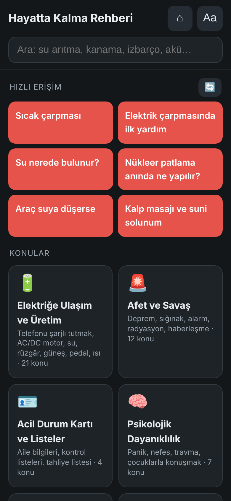
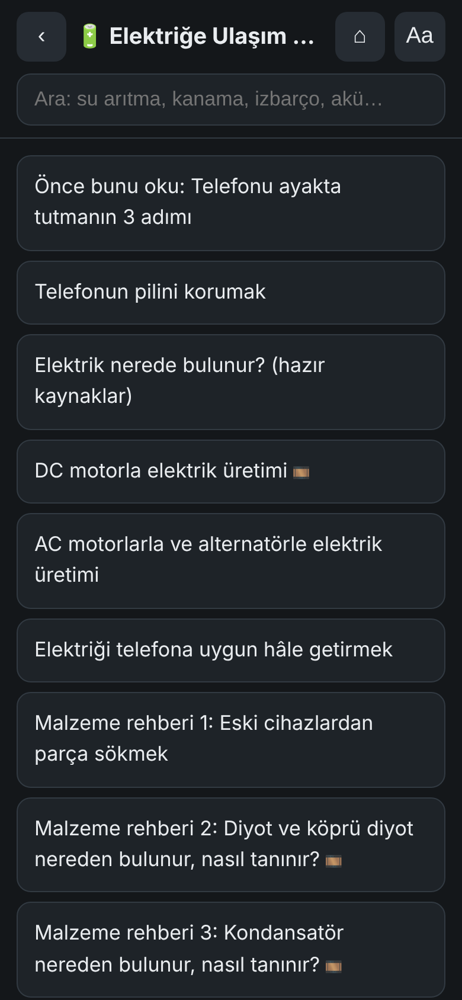

# Hayatta Kalma Rehberi

**İnternet olmadan çalışan, Türkçe, ücretsiz hayatta kalma ve afet rehberi.**

Deprem, savaş, sel, uzun süreli elektrik kesintisi gibi durumlarda telefonunuzda, internete ihtiyaç duymadan açabileceğiniz bir el kitabı. Tek bir HTML dosyasından oluşur, kurulum gerektirmez, reklam ve takip içermez.

👉 **Uygulamayı açın:** https://hayattakal.github.io/hayatta-kalma-rehberi/

## Telefona kurulum

**iPhone (Safari):** Adresi açın → Paylaş → **Ana Ekrana Ekle**. Bir kez internet varken açıp birkaç sayfa gezin. Sonra uçak modunda da çalışır.

**Android (Chrome):** Adresi açın → ⋮ menüsü → **Ana ekrana ekle / Uygulamayı yükle**.

**Bilgisayar veya internet hiç yoksa:** `index.html` dosyasını indirip telefona veya bilgisayara kopyalayın ve tarayıcıda açın.

## İçerik

- **424 konu, 46 bölüm, 85 çizim ve animasyon**
- Elektriğe ulaşım ve üretim (DC/AC motor, su, rüzgâr, güneş, pedal, akü, diyot ve parça bulma rehberi)
- Afet ve savaş, sığınak yapımı, nükleer ve kimyasal tehdit, korunma
- İlk yardım, hastalıklar, bitkisel çözümler, psikolojik dayanıklılık, aile sağlığı
- Su bulma ve arıtma, ateş, barınak, iklim, dağ ve su kenarı
- Yenen ve zehirli bitkiler, av ve tuzaklar, beslenme, bahçe, hayvancılık, gıda saklama
- İlkel yaşam, düğümler, inşaat, tamir, dokuma, basit makineler
- Haberleşme, yön bulma, harita okuma, topluluk düzeni

## Araçlar

El feneri ve SOS, Mors çevirici, düdük, KPR ritmi, pusula ve GPS, Türkiye haritası, hesaplayıcılar, stok ve ilaç takibi, günlük, gün doğumu ve ay evresi, acil durum kartı, sözlük (EN, DE, FR, AR, FA, RU), sınavlar, senaryolar ve sesli okuma.

## Çocuk köşesi

Telif hakkı süresi dolmuş dünya masalları ve fabllar (Türkçe yeniden anlatım), Nasreddin Hoca fıkraları, bilmeceler ve ilginç bilgiler.

## Önemli uyarı

Bu rehber genel bilgi amaçlıdır. Doktor, veteriner, elektrikçi veya resmî afet kurumlarının (AFAD, 112) yerini tutmaz. Mümkün olduğunda her zaman profesyonel yardım alın ve resmî uyarıları izleyin.

## Kaynaklar ve teşekkür

İçerik; AFAD, FEMA ve Ready.gov, CDC, Dünya Sağlık Örgütü (WHO), ABD FDA ve Sığınak Yönetmeliği gibi kamuya açık kaynaklardaki genel bilgiler esas alınarak, sade Türkçeyle yeniden yazılmıştır. Türkiye haritası: turkey-map-react (MIT), il bilgileri: memleketim-tr-cities (MIT). Bütün çizimler bu proje için hazırlanmıştır.

## Katkı

Hata bildirmek veya konu önermek için [Issues](../../issues) bölümünü kullanabilirsiniz.
